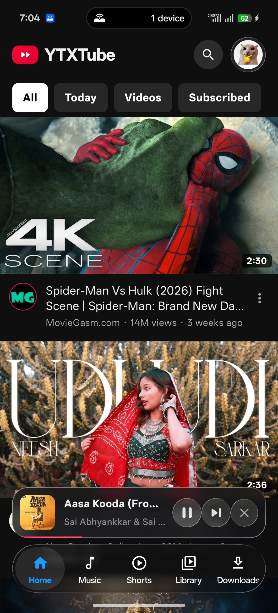
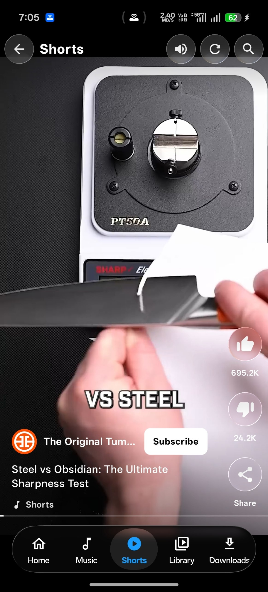
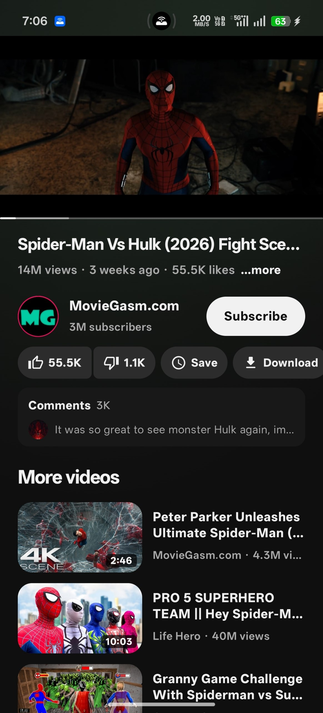
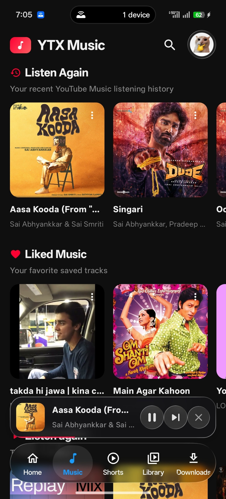
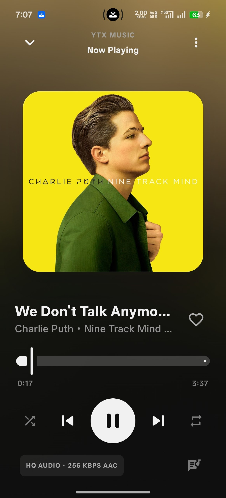
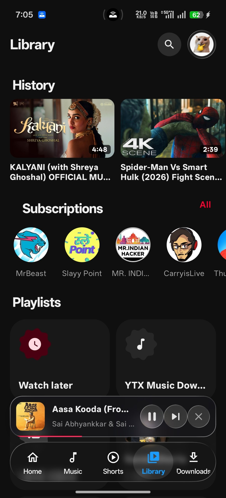
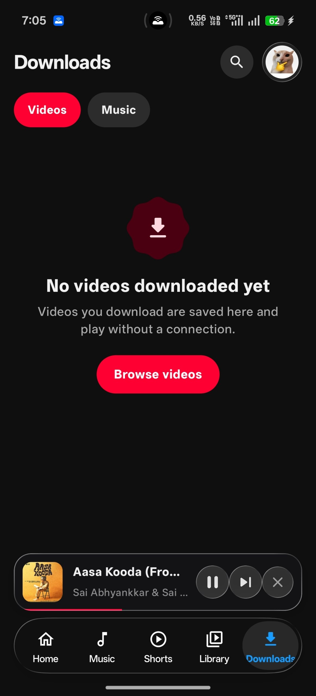
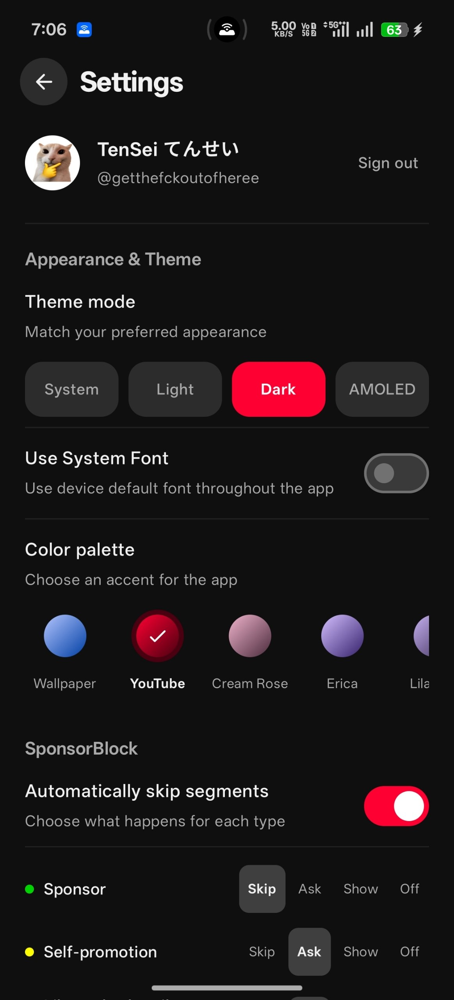

# YTXTube

A lightweight YouTube and YouTube Music client with a modern Liquid Glass UI, ad-free playback, endless personalised Shorts, synced Apple Music-style lyrics, and high-quality downloads.

**Maintainer / developer:** [kairo-xy](https://github.com/Kairo-xy)

## Features

- Live ambient light with its own settings sheet: intensity, reach, softness, saturation, follow speed, fade, status-bar glow and a colour fill for the black bands in fullscreen
- Liquid Glass interface across the player, Shorts, fullscreen controls, settings and music mini player
- Ad-free YouTube and YouTube Music playback
- Personalised Shorts feed with a one-tap fresh batch and loading animation
- Synced lyrics with an Apple Music-style animated lyric view
- High-quality video and audio downloads up to 4K / HDR
- 4K HDR playback and customizable fixed resolution quality lock
- Search, channels, playlists and community posts
- Background playback and picture-in-picture
- Sleep timer and skip silence
- Video chapters with thumbnails, scrubber ticks and haptic feedback while scrubbing
- Equalizer with an animated curve, presets and loudness boost
- Stats for nerds: draggable live panel with network and buffer graphs
- DeArrow titles and blocked keywords / channels
- Faster starts: the first videos in every feed and the next-up videos are resolved ahead of the tap, and the video server connection is pre-warmed
- Android TV support too: the same APK runs on TV with full D-pad navigation

## Download

[Download the latest YTXTube APK](https://github.com/shadowguarda/YTX-Feature-Lab/releases/latest)

Version 2.4.0 · Android 7.0+ · one APK for phones, tablets and Android TV.

## Screenshots

<table>
  <tr>
    <td align="center"><br><sub>Home</sub></td>
    <td align="center"><br><sub>Shorts</sub></td>
    <td align="center"><br><sub>Video player</sub></td>
    <td align="center"><br><sub>Music</sub></td>
  </tr>
  <tr>
    <td align="center"><br><sub>Music player</sub></td>
    <td align="center"><br><sub>Library</sub></td>
    <td align="center"><br><sub>Downloads</sub></td>
    <td align="center"><br><sub>Settings</sub></td>
  </tr>
</table>

## Credits

This project is maintained by [kairo-xy](https://github.com/Kairo-xy).

YTXTube is a fork of [Koustubh12345/YTXTube](https://github.com/Koustubh12345/YTXTube), which is based on [FlashTube](https://github.com/JustaThinker/FlashTube). Playback and extraction use [NewPipeExtractor](https://github.com/TeamNewPipe/NewPipeExtractor). The live ambient light adapts the approach of [MeeTube](https://github.com/yashoncode/meetube) (MIT); see [THIRD_PARTY_NOTICES.md](THIRD_PARTY_NOTICES.md).

Feature research and planned improvements inspired by the wider open-source client ecosystem are tracked in [docs/FEATURE_RESEARCH.md](docs/FEATURE_RESEARCH.md). Inspiration does not imply code reuse; third-party code is only incorporated with license and attribution review.

## Build

Requires JDK 21 and the Android SDK.

```bash
./gradlew :app:assembleRelease
```

The release APK is written to `app/build/outputs/apk/release/app-release.apk`.

Licensed under GPLv3. See [LICENSE](LICENSE).
